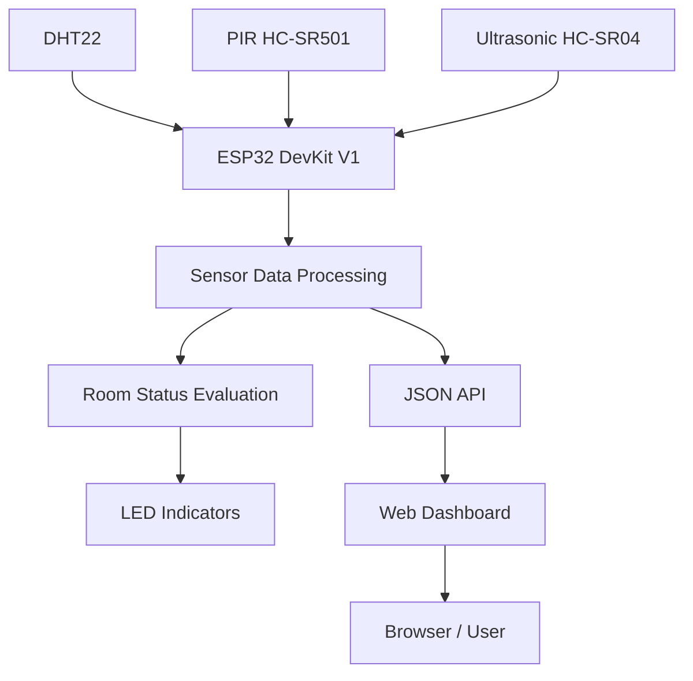

# 🏠 Smart Room Monitoring System

**An IoT-based room monitoring system using ESP32 to monitor temperature, humidity, human movement, and object distance in real time through a web-based dashboard.**

<p align="center">
  
</p>

<p align="center">
  
  
  
  
  
</p>

---

## 📌 Overview

**Smart Room Monitoring System** merupakan proyek Internet of Things (IoT) yang dirancang untuk memantau kondisi ruangan menggunakan ESP32 sebagai mikrokontroler utama.

Sistem ini mengintegrasikan beberapa sensor untuk memperoleh informasi lingkungan dan aktivitas di dalam ruangan. Data sensor diproses oleh ESP32, kemudian ditampilkan melalui dashboard berbasis web yang dapat diakses menggunakan perangkat yang terhubung ke jaringan WiFi yang sama.

Sistem ini memiliki kemampuan untuk:
- Memantau suhu dan kelembapan ruangan.
- Mendeteksi pergerakan menggunakan sensor PIR.
- Mengukur jarak objek menggunakan sensor ultrasonik.
- Mengidentifikasi kondisi ruangan berdasarkan parameter sensor.
- Memberikan indikator kondisi melalui LED merah dan hijau.
- Menampilkan data monitoring secara otomatis melalui web dashboard.

## ✨ Features

| Feature | Description |
|---|---|
| 🌡️ Temperature Monitoring | Memantau suhu ruangan menggunakan DHT22. |
| 💧 Humidity Monitoring | Mengukur kelembapan udara secara berkala. |
| 🚶 Motion Detection | Mendeteksi pergerakan menggunakan PIR HC-SR501. |
| 📏 Distance Detection | Mengukur jarak objek menggunakan HC-SR04. |
| 🚦 Room Status | Menampilkan status NORMAL atau WARNING berdasarkan kondisi sensor. |
| 💡 LED Indicator | LED merah untuk WARNING dan hijau untuk NORMAL. |
| 📊 Web Dashboard | Menampilkan data sensor melalui browser. |
| 🔄 Automatic Update | Memperbarui tampilan dashboard secara berkala tanpa reload halaman. |
| 📡 WiFi Connectivity | Menghubungkan ESP32 ke jaringan WiFi. |

## 🛠️ Hardware Components

| Component | Function |
|---|---|
| ESP32 DevKit V1 | Mikrokontroler utama untuk membaca sensor, memproses data, dan menjalankan web server. |
| DHT22 | Mengukur suhu dan kelembapan udara. |
| PIR HC-SR501 | Mendeteksi pergerakan objek di area sensor. |
| HC-SR04 | Mengukur jarak objek menggunakan gelombang ultrasonik. |
| Red LED | Indikator kondisi WARNING. |
| Green LED | Indikator kondisi NORMAL. |
| Resistor 220–330Ω | Membatasi arus LED. |
| Resistor 1.2kΩ dan 2kΩ | Membentuk voltage divider untuk menurunkan tegangan ECHO HC-SR04. |
| Breadboard & Jumper Wires | Menghubungkan seluruh komponen. |

## 💻 Software & Technologies

- **Arduino IDE** – Development environment.
- **C++** – Programming language.
- **ESP32 Arduino Core** – ESP32 development support.
- **DHT Sensor Library** – Membaca data DHT22.
- **WiFi.h** – Koneksi jaringan WiFi.
- **WebServer.h** – Menjalankan web server pada ESP32.
- **HTML, CSS, JavaScript** – Membangun tampilan dashboard.
- **JSON** – Format pertukaran data sensor antara ESP32 dan dashboard.

## 🔌 Pin Configuration

| Component | ESP32 Pin |
|---|---|
| DHT22 Data | GPIO 4 |
| PIR OUT | GPIO 19 |
| HC-SR04 TRIG | GPIO 5 |
| HC-SR04 ECHO | GPIO 18 (via voltage divider) |
| Red LED | GPIO 25 |
| Green LED | GPIO 26 |

**Power connections:**
- DHT22 VCC → 3V3
- PIR VCC → VIN / 5V
- HC-SR04 VCC → VIN / 5V
- Semua GND komponen terhubung ke GND ESP32.

> ⚠️ **Important:** Pin ECHO HC-SR04 menghasilkan tegangan sekitar 5V, sedangkan GPIO ESP32 menggunakan logika 3.3V. Gunakan voltage divider sebelum menghubungkan ECHO ke GPIO 18. Jangan menghubungkan ECHO langsung ke ESP32.

## ⚙️ System Architecture



### 🔄 How It Works

1. ESP32 melakukan inisialisasi sensor dan koneksi WiFi.
2. DHT22 membaca suhu dan kelembapan.
3. PIR mendeteksi pergerakan di sekitar sensor.
4. HC-SR04 mengukur jarak objek.
5. ESP32 memproses data sensor dan menentukan status ruangan.
6. LED memberikan indikator berdasarkan status.
7. ESP32 menyediakan data sensor melalui endpoint `/api`.
8. Web dashboard mengambil data secara berkala dan memperbarui tampilan secara otomatis.

## 🚦 Room Status Logic

Sistem menggunakan aturan sederhana untuk menentukan kondisi ruangan.

| Condition | Room Status |
|---|---|
| PIR mendeteksi gerakan | WARNING |
| Suhu ≥ 30°C | WARNING |
| Jarak objek > 0 cm dan ≤ 50 cm | WARNING |
| Tidak ada kondisi di atas | NORMAL |

**LED Indicators:**

- 🟢 Green LED → NORMAL
- 🔴 Red LED → WARNING

> Note: Status merupakan hasil evaluasi berdasarkan aturan sederhana, bukan sistem keamanan atau deteksi bahaya profesional.

## 📊 Monitoring Dashboard

Dashboard web digunakan untuk menampilkan hasil pembacaan sensor secara berkala.

Informasi yang ditampilkan:
- Temperature (°C)
- Humidity (%)
- Motion Detection
- Object Distance (cm)
- Room Status
- WiFi Connection Status

Dashboard mengambil data dari endpoint API ESP32 menggunakan JavaScript `fetch()` dengan interval pembaruan 1.5 detik.

**Data refresh:** Every 1.5 seconds  
**Communication:** HTTP / JSON  
**Access:** Browser on the same WiFi network

> Automatic refresh menggunakan metode periodic polling, bukan WebSocket atau real-time streaming.

### 📷 Dashboard Preview

Tambahkan screenshot dashboard milikmu di folder `docs/`, kemudian tampilkan di sini:

<p align="center">
  
</p>

## 🚀 Installation & Setup

### 1. Clone Repository

```bash
git clone https://github.com/USERNAME/smart-room-monitoring-esp32.git
```

```bash
cd smart-room-monitoring-esp32
```

### 2. Install Arduino IDE

Download Arduino IDE:

https://www.arduino.cc/en/software

Pastikan ESP32 Board Package sudah terpasang melalui Boards Manager.

### 3. Install Required Libraries

Install library berikut melalui Arduino IDE Library Manager:

- DHT sensor library by Adafruit
- Adafruit Unified Sensor

Library `WiFi.h` dan `WebServer.h` tersedia melalui ESP32 Arduino Core.

### 4. Configure WiFi

Buka file `SmartRoomMonitoring.ino`, lalu sesuaikan konfigurasi WiFi:

```cpp
const char* WIFI_SSID = "YOUR_WIFI_NAME";
const char* WIFI_PASSWORD = "YOUR_WIFI_PASSWORD";
```

**Security Note:** Jangan mengunggah kredensial WiFi asli ke repository publik.

### 5. Upload Program

1. Hubungkan ESP32 ke komputer menggunakan USB.
2. Buka `SmartRoomMonitoring.ino`.
3. Pilih board ESP32 Dev Module.
4. Pilih port yang sesuai.
5. Klik Upload.
6. Buka Serial Monitor dengan baud rate sesuai konfigurasi program.

### 6. Access Dashboard

Setelah ESP32 berhasil terhubung ke WiFi, periksa IP Address melalui Serial Monitor.

Buka browser dan akses:

```text
http://ESP32_IP_ADDRESS
```

Pastikan perangkat yang digunakan untuk membuka dashboard terhubung ke jaringan WiFi yang sama.

## 🧪 Testing & Validation

Pengujian dilakukan untuk memastikan setiap komponen dan fitur sistem bekerja sesuai fungsinya.

| No. | Testing Scenario | Expected Result |
|---|---|---|
| 1 | ESP32 WiFi Connection | ESP32 berhasil terhubung dan memperoleh IP Address. |
| 2 | Temperature Reading | DHT22 menampilkan data suhu. |
| 3 | Humidity Reading | DHT22 menampilkan data kelembapan. |
| 4 | Motion Detection | PIR mendeteksi perubahan gerakan. |
| 5 | Distance Measurement | HC-SR04 membaca jarak objek. |
| 6 | Room Status Evaluation | Status berubah sesuai kondisi sensor. |
| 7 | LED Indicator | LED merah/hijau menyala sesuai status. |
| 8 | Web Dashboard | Data sensor ditampilkan melalui browser. |
| 9 | Automatic Dashboard Update | Tampilan diperbarui tanpa reload halaman. |

### 📸 Testing Documentation

Simpan dokumentasi pengujian di:

```text
docs/
└── hasil-pengujian/
    ├── serial-monitor.png
    ├── sensor-dht22.png
    ├── motion-detection.png
    ├── distance-detection.png
    └── dashboard.png
```

## 📁 Project Structure

```text
smart-room-monitoring-esp32/
│
├── SmartRoomMonitoring.ino
├── README.md
│
└── docs/
    ├── banner.png
    ├── dashboard.png
    ├── rangkaian.jpg
    ├── deskripsi-sistem.md
    │
    └── hasil-pengujian/
        ├── serial-monitor.png
        ├── sensor-dht22.png
        ├── motion-detection.png
        └── distance-detection.png
```

## 🔮 Future Development

Beberapa pengembangan yang dapat ditambahkan:

- [ ] Penyimpanan histori data sensor ke database.
- [ ] Grafik perubahan suhu dan kelembapan.
- [ ] Notifikasi ketika kondisi WARNING terdeteksi.
- [ ] Monitoring dari luar jaringan lokal melalui backend/cloud.
- [ ] WebSocket untuk komunikasi data secara real-time.
- [ ] Sistem autentikasi dashboard.
- [ ] Penanganan error dan status sensor yang tidak terdeteksi.

## ⚠️ Limitations

- Dashboard saat ini diakses melalui jaringan WiFi lokal.
- Pembaruan dashboard menggunakan periodic polling.
- PIR mendeteksi pergerakan, bukan identitas atau jumlah orang.
- HC-SR04 mengukur jarak, bukan mengenali jenis objek.
- Status NORMAL/WARNING merupakan aturan sederhana berdasarkan parameter yang ditentukan.
- Pembacaan sensor dapat dipengaruhi kondisi lingkungan dan pemasangan perangkat.

## 👨‍💻 Developer

**Muhammad Saiful Amin**

Information Technology Student  
Universitas 'Aisyiyah Yogyakarta

Interested in:
- Internet of Things (IoT)
- Full-Stack Development
- Cyber Security
- Digital Forensics

<p align="left">
  <a href="https://github.com/kaliskehidupan">
    
  </a>
</p>

---

<p align="center">
  **SMART ROOM MONITORING SYSTEM**
  <br>
  *Connecting Sensors, Processing Data, Monitoring Spaces.*
  <br><br>
  Made with ❤️ using ESP32 and IoT Technology.
</p>
